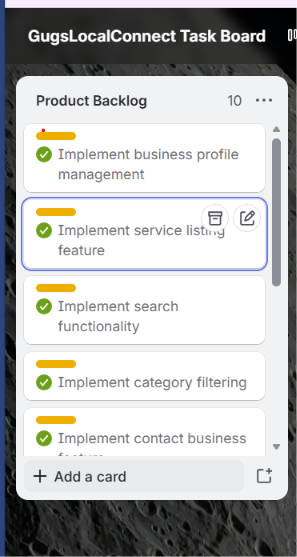
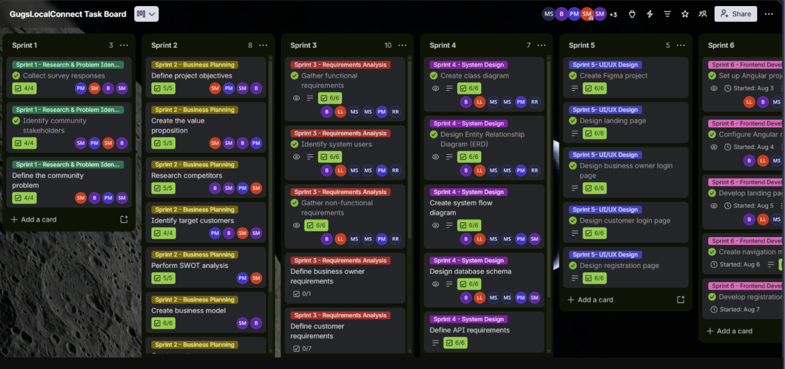

# Lithabile Lalela — Digital Portfolio
### PRP370S | Project Presentation 3
### SEMESTER 1:

---

##  GitHub Student Account

---

##  CV
[View my CV](https://lalela-lithabile.github.io/cv.html)

### Reflection on Coding in Markdown

**Situation:**
As part of the Project Presentation 3 module, I was required to design
and develop a digital portfolio to showcase my work readiness. Initially,
I assumed the task involved building a traditional website, as I had
already begun developing one independently.

**Task:**
Upon receiving the brief, I learned that the portfolio had to be coded
using Markdown language and hosted on GitHub. This introduced two
unfamiliar elements: Markdown as a formatting language, and GitHub as a
deployment platform.

**Action:**
I conducted independent research to understand what Markdown is and how
it functions. I found that Markdown itself was relatively straightforward
to learn. The greater challenge was working within GitHub — specifically
understanding how to commit changes, manage repositories, and deploy
content. I worked through these processes by consulting online resources
and applying what I learned through trial and error.

**Result:**
I successfully created and published my portfolio using Markdown on
GitHub. Through this process, I developed a foundational understanding
of Markdown syntax and improved my confidence in using GitHub as a
version control and deployment platform. I now appreciate Markdown as
a practical and efficient tool for web-based communication.

---

##  Mock Interview Video

  

### Reflection on Mock Interview Video 

**Situation:**
As part of the work readiness component of this module, I was required
to record a mock interview video to simulate a real-world job interview
experience.

**Task:**
I needed to select appropriate interview questions, prepare my responses,
record the video, and submit it as part of my digital portfolio.

**Action:**
I selected questions from the provided brief that I felt most confident
answering. I practised my responses in advance to ensure I was prepared.
Despite my preparation, I experienced significant nerves during the
recording — a challenge I had not fully anticipated, as the anxiety of
being recorded was comparable to, if not greater than, the pressure of
a real interview setting.

**Result:**
Although I did not perform as well as I had hoped due to nerves, the
experience was highly valuable. It highlighted the importance of
interview preparation and exposed areas where I need to grow,
particularly in managing anxiety under pressure. This exercise gave me
a realistic preview of professional interview settings and motivated me
to continue practising my communication skills.

---

##  GitHub Pages

**Evidence:** 

### Reflection on GitHub Pages

**Situation:**
Once my portfolio content was complete, I was required to deploy it as
a live website using GitHub Pages so that it could be publicly accessible
and submitted as evidence.

**Task:**
My task was to configure my GitHub repository to publish via GitHub Pages
and ensure the portfolio was fully functional and accessible via a public
URL.

**Action:**
I researched the deployment process using online resources, which provided
clear step-by-step guidance. I followed these instructions to enable
GitHub Pages through my repository settings and verified that the site
was live and displaying correctly.

**Result:**
My portfolio was successfully deployed and is publicly accessible at
https://lalela-ithabile.github.io/. This experience taught me that
deploying a website does not have to be a complex process when the right
tools and resources are used. It also reinforced my understanding of how
GitHub can serve as both a version control system and a hosting platform.

## Semester 2 – Entrepreneurial WIL Project

**GugsLocalConnect**

GugsLocalConnect is a community-based digital platform designed to connect residents of Gugulethu with local businesses and service providers. The project aims to improve the visibility of local businesses, make services easier to discover, and support the local community.

Our team used Agile principles to organise tasks, define requirements, plan sprints, assign responsibilities, and track progress using Trello.

**My Role:** Analyst

My responsibility was to analyse user needs and help define system requirements and user stories to guide the development of the platform.

**Project Evidence:**

- **Live Application:** [Visit GugsLocalConnect](https://gug-local-connect1-ashen.vercel.app/)
- **Frontend Repository:** [View Frontend on GitHub](https://github.com/BongikaziMnyamana/GugLocalConnect1)
- **Backend Repository:** [View Backend on GitHub](https://github.com/sethujunior/GugsLocalConnect-Backend)
- **Trello Task Board:** [View GugsLocalConnect Board](https://trello.com/invite/b/69f8a3a0575df2b4dc923cc0/ATTIdade644f2320a582ad4ddaf770408593A323F557/gugslocalconnect-task-board)

## Agile Team Charter

---

**Evidence:** [View my Agile Team Charter](https://github.com/Lalela-Lithabile/Lalela-Lithabile.github.io/blob/main/PRP3.TEAM.CHARTER.1.docx)

The Agile Team Charter outlines the purpose of GugsLocalConnect, the team's vision, roles and responsibilities, shared values, communication methods, project goals, milestones, and team agreements. It establishes a common understanding of how the team will collaborate and work towards developing a platform that connects residents with local businesses and service providers.

### Reflection on the Agile Team Charter 

**Situation:**

Our team needed a clear understanding of the GugsLocalConnect project's purpose, goals, and expectations. Since each member had a different responsibility, we needed an agreement that would guide our collaboration and help everyone work towards the same objective.

**Task:**

As the Analyst, my responsibility was to understand the project's objectives and focus on identifying user needs and system requirements. I needed to understand how the platform could benefit residents and local service providers so that the requirements would support the intended purpose of the system.

**Action:**

The team used the Agile Team Charter to establish responsibilities, agree on shared values, and identify communication methods. We used WhatsApp and team meetings to discuss project activities, while Trello helped us organise tasks and monitor progress. I used my understanding of the project's goals to recognise the importance of clear requirements and ensuring that the system addressed users' needs.

**Result:**

The charter helped establish a shared direction and improved my understanding of how clear responsibilities and communication support teamwork. I learned that an Analyst plays an important role in understanding user needs and defining requirements that guide system development. This experience also helped me appreciate how Agile practices encourage collaboration, accountability, and continuous improvement throughout a project.

## User Stories and Tasks

---

**Evidence:** [View User Stories and Tasks on Trello](https://trello.com/invite/b/69f8a3a0575df2b4dc923cc0/ATTIdade644f2320a582ad4ddaf770408593A323F557/gugslocalconnect-task-board)

**Screenshot Evidence: Sprint 3 – Identify System Users**

The screenshot shows a Sprint 3 user story focused on identifying the different users of GugsLocalConnect, including customers, business owners, and administrators. This helps the team understand who will use the platform and determine the appropriate roles and access levels.

### Reflection on User Stories and Tasks 

**Situation:**

Our team needed to identify the different users of GugsLocalConnect and understand their needs. This was important because each user group may interact with the platform differently and require different features or permissions.

**Task:**

As the Analyst, my responsibility was to help analyse user needs and identify system requirements that would guide the development of the platform. Understanding the different user groups helped clarify what the system needed to support.

**Action:**

The team documented the user story in Trello and used a checklist to break the task into smaller activities and track completion. This helped organise the work and made progress easier to monitor.

**Result:**

I learned how user stories translate user needs into clear development tasks. I also gained a better understanding of why identifying users and their access levels is important when defining system requirements and planning a system that meets users' needs.

## Product Backlog

---

**Evidence: Product Backlog**

The Product Backlog contains the main features planned for GugsLocalConnect, including business profile management, service listings, search functionality, category filtering, and contacting businesses. These features help organise the functionality required to meet the needs of residents and local service providers.

### Reflection on the Product Backlog (STAR Method)

**Situation:**

Our team needed to identify and organise the main features required for GugsLocalConnect. Having a backlog helped us keep track of the functionality planned for the platform.

**Task:**

As the Analyst, my responsibility was to understand user needs and help identify requirements that could be translated into system features.

**Action:**

The team organised planned features in Trello, including business profile management, service listings, search functionality, and category filtering. This made the planned work easier to view and helped the team keep track of the features required.

**Result:**

I learned how a Product Backlog helps organise requirements and prioritise the work needed to develop a system. I also gained a better understanding of how user needs can be translated into features that provide value to the intended users.

## Sprint Backlog

---

**Evidence: GugsLocalConnect Sprint Board**

The screenshot shows the team's work organised into six sprints, covering research and problem identification, business planning, requirements analysis, system design, UI/UX design, and frontend development. The Trello board helps the team organise tasks, monitor progress, and keep track of planned activities throughout the project.

### Reflection on the Sprint Backlog (STAR Method)

**Situation:**

Our team needed to divide the GugsLocalConnect project into manageable stages so that the work could be organised and monitored throughout development.

**Task:**

As the Analyst, my responsibility was to understand the system requirements and how they related to the tasks planned for each sprint. This helped me understand how requirements contributed to the overall project objectives.

**Action:**

The team used Trello to organise tasks into sprints, with each sprint focusing on a different project stage. The board included activities such as gathering requirements, identifying system users, designing the database, and developing user interface pages.

**Result:**

I learned how sprint backlogs help teams organise project work and monitor progress. I also gained a better understanding of how system requirements connect to development activities and how Agile planning supports teamwork and project coordination.

## Agile Logbook

---

**Evidence:** [View my Agile Logbook (PDF)](PRP37XS_Agile_Logbook.pdf)

The Agile Logbook records the team's progress on GugsLocalConnect between 4 and 7 August 2026. It includes daily updates on frontend development, the Brand Guide, business model planning, upcoming tasks, and challenges affecting the project.

### Reflection on the Agile Logbook 

**Situation:**

Our team needed to record project progress and keep track of completed work, planned activities, and challenges during development.

**Task:**

As the Analyst, I needed to understand the project's progress and how the team's activities related to the requirements and objectives of GugsLocalConnect.

**Action:**

The logbook documented daily progress, upcoming tasks, and possible risks. The team also used a taskboard and walkthrough questions to review work, identify challenges, and discuss what needed to be completed next.

**Result:**

I learned that an Agile Logbook helps teams monitor progress, communicate challenges, and plan their next steps. It also helped me understand the importance of regular updates and identifying risks early so that the team can work towards its project goals.
